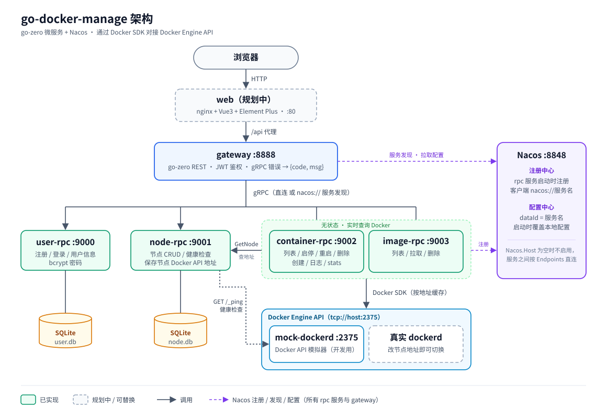
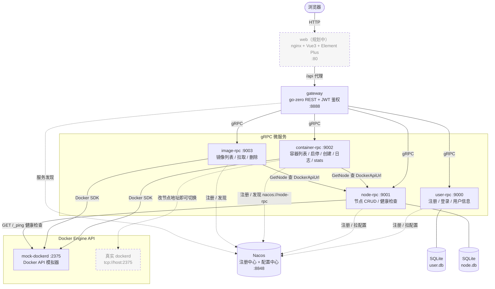
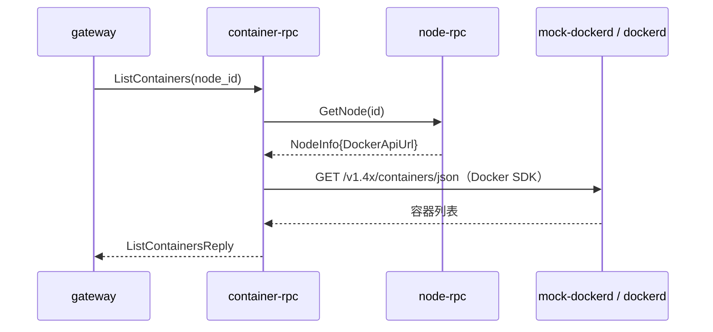

# go-docker-manage

基于 **go-zero 微服务 + Nacos** 的 Docker 管理系统。各服务通过官方 Docker SDK 对接 Docker Engine API，开发阶段由 `mock-dockerd` 模拟 Docker daemon。要切到真实 Docker，只需把节点的 Docker API 地址改成真实地址，业务代码不用改。

> 当前进度：gateway、user-rpc、node-rpc、container-rpc、image-rpc、mock-dockerd、Web UI（Vue3 + Element Plus）与 Docker Compose 部署脚本均已实现；本地直连模式全链路验证通过。

## 架构图



主要流程：
- 浏览器经 Web UI 把 `/api` 请求交给 gateway，gateway 校验 JWT 后，用 gRPC 调用后面的服务。
- container-rpc / image-rpc 本身不存数据：每次请求先向 node-rpc 查询目标节点的 Docker API 地址，再用 Docker SDK 直接调用该节点。
- 节点地址可以指向 `mock-dockerd`（开发用），也可以指向真实的 dockerd。
- 所有服务启动时把自己注册到 Nacos，并从 Nacos 拉取配置。不配置 Nacos 时，服务之间按 `Endpoints` 直连。

<details>
<summary>Mermaid 版本（可编辑源码）</summary>



</details>

### 调用链路示例：查看某节点的容器列表



## 目录结构

```
app/
  user/rpc/        用户服务（SQLite，bcrypt 密码）
  node/rpc/        节点服务（SQLite，/_ping 健康检查）
  container/rpc/   容器服务（无状态，实时查 Docker API）
  image/rpc/       镜像服务（列表 / 拉取 / 删除）
  gateway/         API 网关（REST + JWT，HTTP → gRPC）
pkg/
  nacosx/          go-zero ⇄ Nacos 适配：服务注册、nacos:// gRPC resolver、配置中心拉取
  dockerx/         Docker SDK 客户端（按地址缓存复用）
  errorx/          统一业务错误码
  zrpcx/           zrpc 客户端构造：启用 Nacos 走服务发现，否则直连
examples/greeter/  最小 zrpc 微服务示例（服务端 + 客户端）
docs/              架构图（architecture.svg）
mock-dockerd/      Docker Engine API 模拟器（容器/镜像/日志/stats，可持久化为 JSON）
web/               管理界面（Vue3 + Element Plus：仪表盘/节点/容器/镜像）
deploy/            Dockerfile×3、nginx.conf、docker-compose.yml、nacos-init 配置导入
scripts/           deploy.sh 一键部署、bootstrap-api.sh 初始化（建号/建节点）
```

## 快速开始

```bash
go mod tidy          # 首次构建前执行，补齐依赖
go build ./...
go test ./...

# 1. 启动模拟 Docker daemon
go run ./mock-dockerd -addr :2375 -data state.json

# 2. 启动各服务（配置路径是相对路径，需在服务目录内运行）
cd app/user/rpc      && go run . -f etc/user.yaml
cd app/node/rpc      && go run . -f etc/node.yaml
cd app/container/rpc && go run . -f etc/container.yaml
cd app/image/rpc     && go run . -f etc/image.yaml
cd app/gateway       && go run . -f etc/gateway.yaml   # HTTP :8888
```

网关主要接口（除注册 / 登录 / health 外都需要 `Authorization: Bearer <token>`）：

| 接口 | 说明 |
|---|---|
| `POST /api/auth/register`、`POST /api/auth/login` | 注册 / 登录（返回 JWT） |
| `GET/POST /api/nodes`、`DELETE /api/nodes/:nodeId`、`POST /api/nodes/:nodeId/health` | 节点管理 |
| `/api/nodes/:nodeId/containers[/:containerId[/:action\|/logs\|/stats]]` | 容器管理 |
| `/api/nodes/:nodeId/images`、`POST /api/nodes/:nodeId/images/pull` | 镜像管理 |
| `GET /api/dashboard` | 节点 / 容器 / 镜像统计 |

mock-dockerd 兼容 docker CLI，可以直接用来验证：`docker -H tcp://127.0.0.1:2375 ps -a`。

前端开发模式：`cd web && npm install && npm run dev`（:5173，`/api` 代理到本地 gateway）。

## 部署到 192.168.112.138（Docker Compose）

```bash
bash scripts/deploy.sh     # rsync 源码 → 服务器 compose build/up → 自动初始化
```

启动内容：Nacos（standalone，derby 内嵌存储）+ nacos-init（向配置中心导入 5 个 dataId）+
mock-dockerd + 4 个 rpc 服务 + gateway + web，SQLite / Nacos / mock 状态均挂 Docker volume。

- Web UI：<http://192.168.112.138/>（admin / admin123，首次部署脚本会自动创建）
- API：<http://192.168.112.138:8888/api/health>
- Nacos 控制台：<http://192.168.112.138:8848/nacos>（nacos/nacos）

容器部署时通过环境变量 `GDM_NACOS_HOST=nacos` 注入注册中心地址；服务启动时先从配置中心
拉取同名 dataId（`deploy/nacos-init/configs/`），拉不到则用镜像内的本地配置。

## 配置与 Nacos

- 本地的 `etc/<服务>.yaml` 只放启动信息（Name、ListenOn、Nacos 地址）。
- `Nacos.Host` 为空（默认）时不使用 Nacos，服务之间按 `Endpoints` 直连，适合本地调试。
- `Nacos.Host` 填上地址后：
  - 启动时从配置中心拉取与服务同名的 dataId（如 `node-rpc`），覆盖本地配置；
  - 服务实例自动注册到 Nacos；
  - 客户端用 `nacos://<服务名>` 做服务发现。

## 重新生成 protobuf 代码

在仓库根目录执行。需要 [protoc](https://github.com/protocolbuffers/protobuf/releases)（本地放在 `.tools/`，该目录不提交）以及插件 `go install google.golang.org/protobuf/cmd/protoc-gen-go@latest` 和 `google.golang.org/grpc/cmd/protoc-gen-go-grpc@latest`：

```bash
PATH="$HOME/go/bin:$PATH" .tools/bin/protoc.exe -I app/<svc>/rpc -I .tools/include \
  --go_out=. --go_opt=module=github.com/hequan2017/go-docker-manage \
  --go-grpc_out=. --go-grpc_opt=module=github.com/hequan2017/go-docker-manage \
  app/<svc>/rpc/<svc>.proto
```

## License

见 [LICENSE](LICENSE)。
